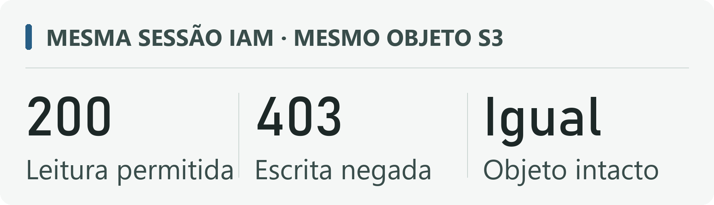

# Cloud Security Detection Lab

**Infraestrutura temporária e privilégio mínimo no Amazon S3.**

Provisionei um bucket privado com CloudFormation na região de Ohio (`us-east-2`). Com a mesma sessão temporária de IAM, li um objeto fictício e confirmei que a tentativa de sobrescrita foi recusada.

<picture>
  <source media="(prefers-color-scheme: dark)" srcset="docs/img/resumo-escuro.png">
  
</picture>

[Validação de IAM](docs/VALIDACAO-IAM-S3-OHIO.md) · [Ciclo do CloudFormation](docs/VALIDACAO-IAC-OHIO.md) · [Template](infra/bucket-evidencias.json)

## Entregas e estado

- **CloudFormation.** Criação e remoção da mesma stack e do mesmo bucket confirmadas em Ohio. [Aceite de 24/11/2026](docs/VALIDACAO-IAC-OHIO.md#aceite)
- **IAM.** A mesma sessão recebeu **200** em `GetObject` e **403 AccessDenied** em `PutObject`. O operador confirmou conteúdo e ETag preservados. Teste aceito em 24/11/2026. [Evidência](docs/VALIDACAO-IAM-S3-OHIO.md#aceite)
- **CloudTrail.** Três detecções validadas com eventos reais de gerenciamento em Ohio. O detector emitiu um sinal para cada mudança de bloqueio público, mudança de política e remoção do bucket. [Resultado e reprodução](docs/VALIDACAO-CLOUDTRAIL-S3-OHIO.md)

## Acesso e recursos

O laboratório usa uma conta de teste, até dois papéis IAM com sessões temporárias e um bucket privado com até **100 MiB** de dados fictícios. O template declara bloqueio de acesso público, SSE-S3 e exclusão do bucket com a stack. O relatório de IAM documenta a checagem das proteções pela API e a limpeza dos recursos criados no ensaio. [Escopo e encerramento](docs/EVIDENCIAS-M4.md)

## Custo

O limite é **US$ 0 em cobranças**. Antes de provisionar, confira o plano gratuito ativo, os créditos e a elegibilidade das operações. Se a AWS exigir mudança de plano, suspenda o ensaio. O painel mostrou US$ 0,00 imediatamente após o teste de IAM. A conferência do faturamento consolidado segue no M4. [Regras do Free Plan](https://docs.aws.amazon.com/awsaccountbilling/latest/aboutv2/free-tier-plans.html) · [Andamento do M4](https://github.com/raphaelguterres/raphaelguterres/blob/main/roadmaps/PROGRESSO.md#m4--cloud-security-e-iac--110180-h-estimadas)
